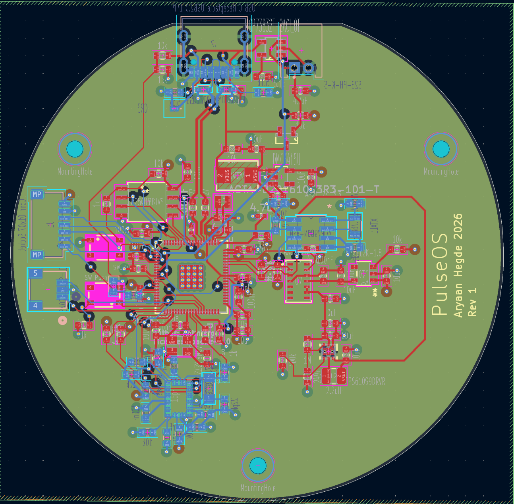
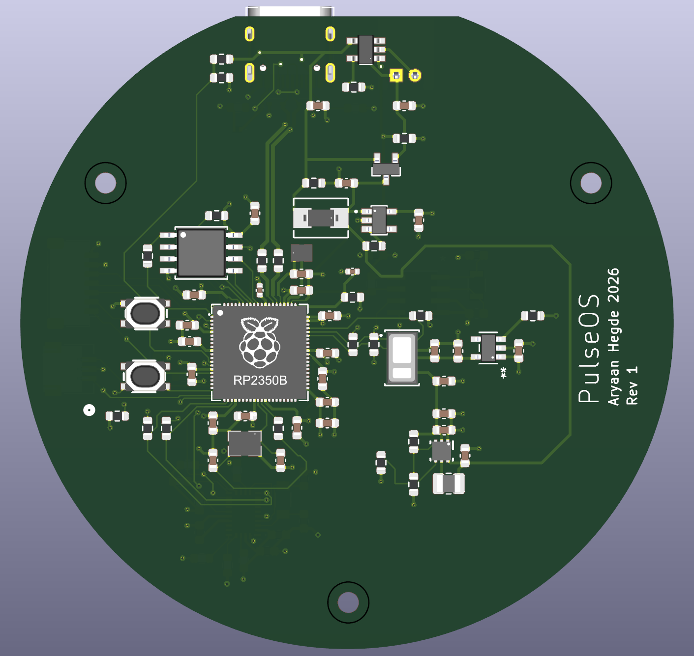
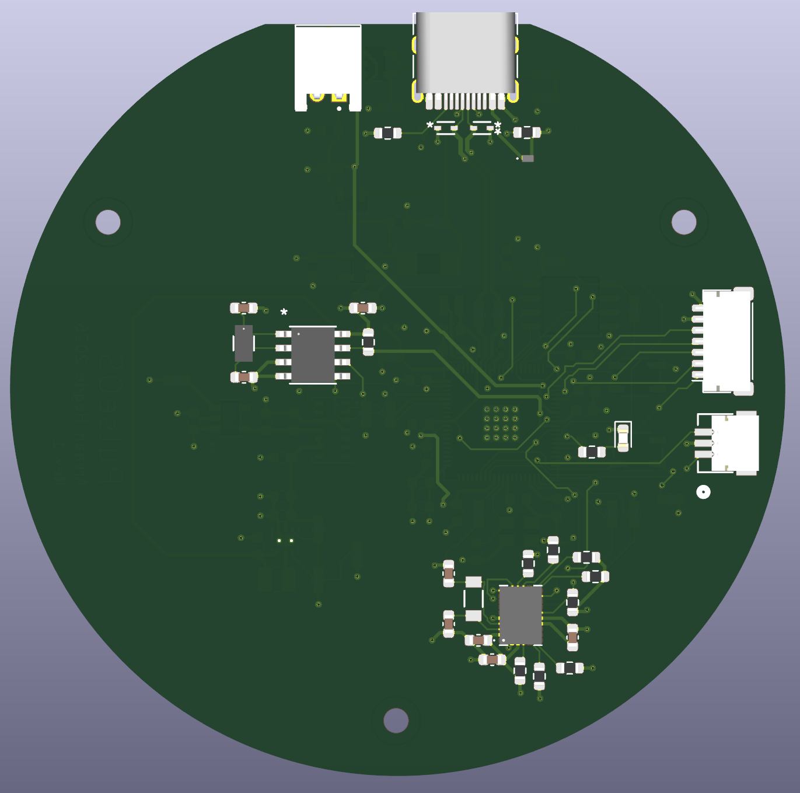

# PulseOS
A smartwatch that can detect, monitor and display your heart rate. Contains a custom 4-layer, 35 mm circular PCB based on the RP2350B microcontroller with a heart-rate PPG sensor, RTC, IMU and TFT display peripherals. The smartwatch features a LiPo battery that can be charged through the PCB via a USB cable. Additionally, the board also contains a switchover mechanism so that you can power the watch solely through USB.

The board routing can be seen below:

Additionally, a 3D model of this PCB is also shown below:
| Left Image | Right Image |
| :---: | :---: |
|  | 

